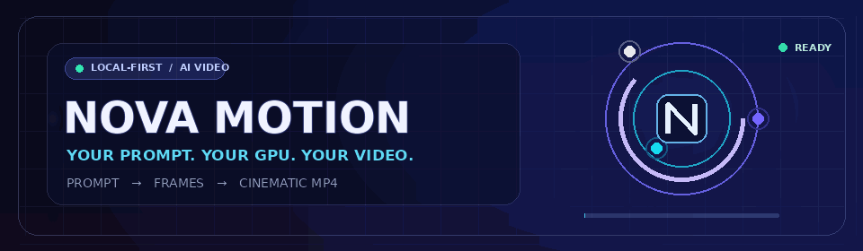
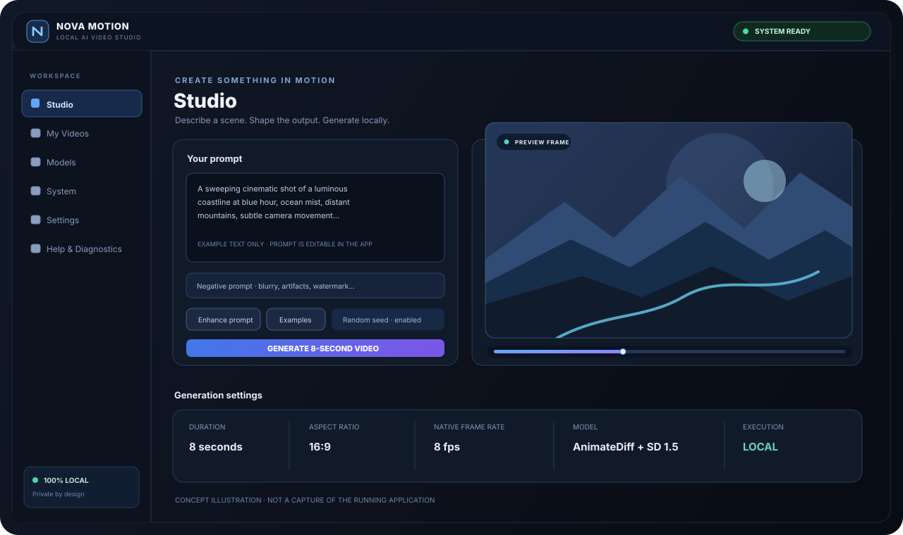
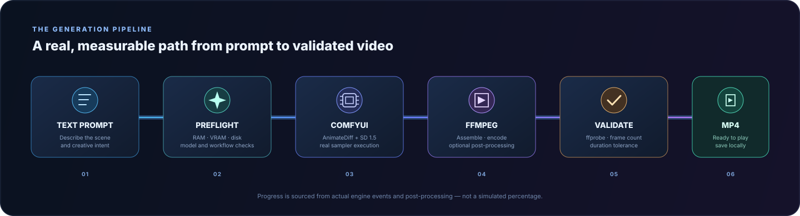

# NOVA MOTION

### Turn a written idea into an eight-second cinematic video — on your own machine.

A Windows-first, local AI video studio powered by **ComfyUI · AnimateDiff · Stable Diffusion 1.5 · FFmpeg**.

  
  
  
  

  
  
  
  
  

  
  
  
  
  

[Quick start](#-get-started) · [Features](#-what-you-get) · [Architecture](#-how-it-works) · [Compatibility](#-hardware--realistic-expectations) · [Docs](#-documentation)

---

## What is NOVA MOTION?

NOVA MOTION is a **local video-generation workstation**, not a hosted website or a cloud wrapper. Write a scene description, choose a model and generation settings, then let your own NVIDIA GPU run the workflow. The result is assembled, checked and saved in your local video library.

- **Your machine does the generation.** The backend and ComfyUI bind to loopback addresses; they are not exposed as a LAN service by default.
- **Your output stays local.** Generated videos, thumbnails, model files and the SQLite job database live inside your project folder.
- **The interface reports what actually happened.** Engine progress and post-processing stages are measured; an output is not marked complete until media validation passes.
- **The limitations are visible.** Interpolation, conventional resizing and multi-shot assembly are identified rather than presented as new AI-generated detail.

> **Important distinction:** the one-time installer and model manager need internet access to download dependencies and model weights. After those files are installed, the generation workflow is designed to run locally without a cloud inference account. The application does not include built-in user accounts, subscriptions or telemetry.

## 🌐 Live project pulse

The badges above refresh from GitHub and the visitor-counter service. The README views number is an **approximate page-load count**, not a count of unique people; it is provided by an external counter and may be affected by image caching.

Want to help shape the next build? Open a bug report, suggest an improvement, or share a render in the community section below. The repository's actual traffic analytics are also available to maintainers under **Insights → Traffic**.

## A look inside the studio

Concept illustration for this repository's documentation — not a screenshot of a running application. The actual interface is implemented in <code>frontend/src/</code>.

## ✨ What you get

| Capability | What it does |
|---|---|
| **Text-to-video studio** | Compose positive and negative prompts, choose presets and seed, configure duration, aspect ratio, sampler and export settings. |
| **Model library** | Browse supported profiles, inspect their source and license information, install with resumable downloads, and verify model files with SHA-256. |
| **Measured generation progress** | Follow the job state machine, engine events, stage details and an ETA only after the sampler rate has been measured. |
| **Local video library** | Preview, search, sort, download, inspect and remove generated videos; open the output folder in Explorer. |
| **Hardware awareness** | Read CPU, RAM, dedicated NVIDIA VRAM, disk, driver, engine and FFmpeg status. Shared system memory is not misreported as dedicated VRAM. |
| **Resource preflight** | Check available resources, installed model files and live workflow compatibility before submitting a job. |
| **Recovery and diagnostics** | Inspect logs, download a local diagnostic bundle, repair the installation and recover from common engine or resource errors. |
| **Low-memory operation** | Run jobs sequentially, start ComfyUI with low-VRAM options, release engine memory after jobs and allow one bounded lower-memory retry after CUDA OOM. |

## 🎬 How it works

1. **Describe:** enter a prompt and choose your model/output settings.
2. **Preflight:** NOVA checks memory, storage, model availability and the live ComfyUI workflow.
3. **Generate:** the backend submits the workflow to the locally managed ComfyUI engine.
4. **Assemble:** FFmpeg encodes frames and applies only the post-processing options you selected.
5. **Validate:** FFprobe checks the output before the job can be marked <code>COMPLETED</code>.
6. **Save:** the MP4 and its metadata appear in **My Videos** and your local <code>outputs/</code> folder.

### The actual job lifecycle

<code>QUEUED → PREFLIGHT → INITIALIZING → GENERATING → ASSEMBLING → INTERPOLATING → ENCODING → VALIDATING → COMPLETED</code>

A job can also end as <code>FAILED</code> or <code>CANCELLED</code>. Optional stages are skipped when they are not selected; the interface does not pretend they ran.

## 🧰 Hardware & realistic expectations

NOVA MOTION is intentionally designed around a modest NVIDIA Windows laptop, but video diffusion remains resource-intensive. Compatibility is evaluated using detected dedicated VRAM and live system resources—not the GPU's advertised shared-memory figure.

| Area | Reference configuration / behavior |
|---|---|
| Operating system | Windows 10 or 11, 64-bit |
| Python | 3.13 recommended; backend dependencies support Python 3.12/3.13 |
| GPU | NVIDIA GPU with a compatible CUDA driver; AMD, Intel and CPU-only inference are not supported by this configuration |
| Reference GPU | RTX 2050 Laptop, 4 GB dedicated GDDR6 |
| Reference memory | 8 GB system RAM |
| Default generation route | 640×360, 64 frames at 8 fps native, 16 sampling steps |
| Default duration | 8 seconds, validated to within one output frame |
| Execution | One generation at a time; one running job plus one queued job |

**What the output labels mean**

- **8 fps native:** frames generated by the diffusion workflow at its native output rate.
- **16/24 fps interpolated:** FFmpeg motion-compensated interpolation, or optional RIFE when installed. In-between frames are estimates; they are not new diffusion-generated frames.
- **Upscaled ×2:** Lanczos resizing. This is conventional image resizing, **not AI super-resolution**.
- **Multi-shot:** several shorter segments assembled into one output. Motion continuity across cuts is not guaranteed.

On the 4 GB RTX 2050 reference machine, 640×360 is the intended conservative route. Larger resolutions can exceed available VRAM and may be blocked or fail after the single lower-memory retry. Actual time depends on free RAM/VRAM, thermal state, driver and installed model files. Do not treat any sample time as a guarantee.

## 🚀 Get started

### 1. Check the requirements

- Windows 10/11, 64-bit.
- Python 3.13 recommended (3.12 is supported by the backend dependency set).
- NVIDIA GPU and a recent driver compatible with the CUDA-enabled PyTorch wheels used by the installer.
- Internet access for the initial setup and model download.
- Approximately 15 GB or more of free disk space is a sensible starting point; the exact requirement depends on dependencies, selected models and generated videos.
- Node.js 22.22.2+ or 24.15.0+ (24 LTS recommended) only if you need to build the frontend or run its tests yourself. A prebuilt <code>frontend/dist</code> can be used instead.

### 2. Install

1. Clone or download this repository and place it in a folder with sufficient free space, for example <code>C:\NOVA-MOTION</code>.
2. Double-click **<code>scripts\Install-Studio.bat</code>**.
3. The installer creates the backend and engine environments inside the project folder, installs the pinned ComfyUI release, its AnimateDiff support, the CUDA-enabled PyTorch stack and FFmpeg.
4. Model weights are **not** downloaded by the installer. This lets you inspect the model information and license details in the Models page first.

### 3. Install a model

1. Double-click **<code>scripts\Start-Studio.bat</code>**.
2. Your browser opens the local interface at **http://127.0.0.1:8317**.
3. Open **Models**, choose the recommended *AnimateDiff v2 Motion + Stable Diffusion 1.5 (fp16)* profile, read its license information and acknowledge it where required.
4. Start the download (approximately 3.7 GB for the recommended profile). Downloads can resume after interruption and downloaded files are checksum-verified.

### 4. Generate your first video

1. Open **Studio** and write a scene description.
2. Choose the model, 8-second duration, aspect ratio and generation settings.
3. Review the preflight result and press **Generate 8-second video**.
4. Follow the real engine and post-processing stages.
5. After validation, preview or download the MP4 from **My Videos** or find it in <code>outputs/</code>.

To finish, run **<code>scripts\Stop-Studio.bat</code>**. It stops only the processes managed by this installation.

### Useful maintenance scripts

| Script | Purpose |
|---|---|
| <code>Diagnose-Studio.bat</code> | Hardware, ports, engine, FFmpeg and model readiness report. |
| <code>Repair-Studio.bat</code> | Re-check environments, model file sizes/checksums and FFmpeg. |
| <code>Start-Studio.bat</code> | Start the local backend and managed engine. |
| <code>Stop-Studio.bat</code> | Stop NOVA MOTION's managed processes. |

## 🏗️ Architecture

~~~text
React 19 + TypeScript + Vite
        │  local HTTP + WebSocket
        ▼
FastAPI backend ───────────── SQLite job/video metadata
        │
        ├── Job state machine + resource preflight
        ├── Model registry + checksum/license handling
        ├── Progress and recovery management
        └── FFmpeg assembly + ffprobe validation
        │
        ▼
ComfyUI (managed local process)
        │
        ▼
AnimateDiff-Evolved + Stable Diffusion 1.5 (fp16)
        │
        ▼
Local MP4 output + thumbnail + provenance metadata
~~~

The ComfyUI adapter communicates through the documented local HTTP and WebSocket API. Workflow graphs are built by the backend and validated structurally, then against the live engine's <code>/object_info</code> node definitions before submission.

## 📁 Repository map

~~~text
NOVA-MOTION/
├── backend/
│   ├── app/api/          # FastAPI routes
│   ├── app/core/         # Jobs, resources, registry, workflows, safety
│   ├── app/engines/      # ComfyUI engine adapter
│   ├── app/services/     # Generation, models, FFmpeg, validation
│   └── tests/            # Backend and pipeline tests
├── frontend/
│   └── src/
│       ├── components/   # Studio UI and reusable components
│       ├── pages/        # Studio, Videos, Models, System, Settings, Help
│       └── lib/          # API, types, formatting and WebSocket client
├── models/               # Auditable model registry (no weights committed)
├── workflows/            # ComfyUI workflow templates
├── scripts/              # Install, Start, Stop, Diagnose, Repair
├── docs/                 # Compatibility, troubleshooting and licenses
└── CHANGELOG.md
~~~

## 🧪 Development & tests

### Backend

~~~powershell
cd backend
python -m venv .venv
.\.venv\Scripts\Activate.ps1
python -m pip install -r requirements.txt -r requirements-dev.txt
python -m pytest -q
~~~

The backend media tests use real FFmpeg/FFprobe when those tools are available.

### Frontend

~~~powershell
cd frontend
npm ci
npm run typecheck
npm test
npm run build
~~~

GitHub Actions runs the backend tests and frontend typecheck, test suite and production build on pushes and pull requests to <code>main</code>.

## 📚 Documentation

- [Model compatibility](docs/MODEL_COMPATIBILITY.md) — hardware notes and the rationale behind supported and rejected model profiles.
- [Troubleshooting](docs/TROUBLESHOOTING.md) — diagnostics, error codes and recovery steps.
- [Third-party licenses](docs/LICENSES.md) — model, runtime and component license information.
- [Changelog](CHANGELOG.md) — release history.
- [Contributing](CONTRIBUTING.md) — how to report, discuss and submit changes.
- [MIT License](LICENSE) — license for this repository's application code.

## 🔒 Privacy, security & boundaries

- Backend and ComfyUI default to <code>127.0.0.1</code>; do not change these settings to expose the service to an untrusted network.
- No analytics, ads or telemetry are part of the application.
- Prompts, generated videos, thumbnails, logs and database records are kept in the local project directories.
- The initial installer and model manager contact upstream download sources; generation itself uses the local engine.
- Model weights are separate third-party assets and keep their respective upstream licenses. Check each model's license before using or distributing it.
- Avoid sharing diagnostic bundles or logs without reviewing them for local paths and machine details first.

NOVA MOTION is an experimental local creator tool, not a guarantee of professional video quality or compatibility with every NVIDIA GPU. Always check the live readiness report and the model's license before generating.

## 🤝 Join the NOVA MOTION community

This project gets better when creators and developers take part. Choose the kind of contribution that fits you:

| Join in | Open the right GitHub form |
|---|---|
| 🐛 Found a bug? | [Create a bug report](https://github.com/computerengineer1/NOVA-MOTION/issues/new?template=bug_report.yml) |
| 💡 Have an idea? | [Suggest a feature](https://github.com/computerengineer1/NOVA-MOTION/issues/new?template=feature_request.yml) |
| 🎬 Made something with NOVA MOTION? | [Share your showcase](https://github.com/computerengineer1/NOVA-MOTION/issues/new?template=showcase.yml) |
| 🧑‍💻 Want to contribute code? | [Read the contribution guide](CONTRIBUTING.md) |

Pull requests are welcome. Please keep model weights, generated videos, private logs and machine-specific secrets out of commits.

## ⭐ Like the project?

If NOVA MOTION is useful to you, consider giving the repository a **Star**. Bug reports, reproducible issues and thoughtful contributions are welcome:

- [⭐ Star NOVA MOTION](https://github.com/computerengineer1/NOVA-MOTION/stargazers)
- [Report a bug or request a feature](https://github.com/computerengineer1/NOVA-MOTION/issues)
- [Browse the source code](https://github.com/computerengineer1/NOVA-MOTION)

  Built for creators who want local control over their AI video workflow.
  Motion banner is generated from original artwork by <code>scripts/generate_readme_animation.py</code>.

